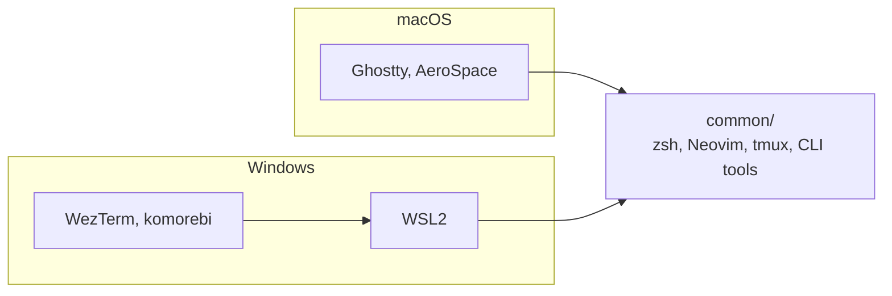

# Dotfiles

[](LICENSE)
-blue)
[](https://github.com/SuperCuber/dotter)
[](https://github.com/sagiegurari/cargo-make)


Unix-first dotfiles for macOS and Windows (via WSL2).

> [!WARNING]
> Feel free to take what you want, but review before installing. `cargo make init` installs packages and symlinks configs into your home directory.

---

## Architecture

The core dev environment (zsh, Neovim, CLI tools) targets unix; Windows reaches it through WSL2. Both platforms converge on the same `common/` configs, and only the GUI layer differs.



---

## Principles

1. **Unix-first**: configs are written for unix. Windows uses WSL2 to run them.
2. **Performance-first**: preference for modern, Rust-based tools (eza, bat, ripgrep, fd).
3. **Easy installation**: `dotter` for symlinks, `cargo-make` for setup automation.

---

## Install

### Prerequisites

Install Rust and cargo-make:

```bash
# Install Rust
curl --proto '=https' --tlsv1.2 -sSf https://sh.rustup.rs | sh

# Verify
rustc --version && cargo --version

# Install cargo-make
cargo install cargo-make
```

### Clone and init

```bash
git clone git@github.com:msetsma/.dotfiles.git
cd .dotfiles
cargo make init
```

### Windows (two-step setup)

On Windows, run init twice: once on the Windows host for native apps, and once inside WSL2 for the dev environment.

```bash
# 1. Windows host (PowerShell/cmd): installs Scoop packages, WezTerm, komorebi
cargo make init

# 2. Inside WSL2: installs zsh, zinit, CLI tools, symlinks common/ configs
cargo make init
```

The repo lives on the Windows filesystem and is accessed from WSL2 via `/mnt/c/Users/<you>/.dotfiles`. Extra Windows tweaks are in [windows/README.md](windows/README.md).

### View available commands

```bash
cargo make help    # Quick reference
cargo make info    # All commands
```

---

## Common Tasks

<details>
<summary><b>Setup & updates</b></summary>

```bash
cargo make init            # Complete environment setup
cargo make update          # Update all tools and packages
cargo make check-outdated  # Check for available updates
cargo make doctor          # System health check
```

</details>

<details>
<summary><b>Package management (cross-platform)</b></summary>

```bash
cargo make pkg-export      # Export packages
cargo make pkg-import      # Import packages
cargo make pkg-cleanup     # Cleanup old versions
cargo make pkg-doctor      # Check for issues
```

Platform-specific: `brew-*` (macOS), `scoop-*` (Windows), `apt` (WSL2/Linux).

</details>

<details>
<summary><b>Dotfile deployment</b></summary>

```bash
dotter # Deploy dotfiles via dotter
```

</details>

<details>
<summary><b>Python CLI tools (uv)</b></summary>

```bash
cargo make uv-tools-list     # List installed tools
cargo make uv-tools-export   # Export to uv-tools.txt
cargo make uv-tools-install  # Install from uv-tools.txt
cargo make uv-tools-upgrade  # Upgrade all
```

</details>

<details>
<summary><b>Utilities</b></summary>

```bash
cargo make clean           # Cleanup caches
cargo make info            # Show all available commands
```

</details>

---

## Tools

> [!NOTE]
> Common tools are cross-platform. Installation methods differ by OS.

### Common (all platforms)

[Neovim](https://neovim.io/) | [Zsh](https://www.zsh.org/) + [zinit](https://github.com/zdharma-continuum/zinit) | [tmux](https://github.com/tmux/tmux) | [Mise](https://github.com/jdx/mise) | [Dotter](https://github.com/SuperCuber/dotter) | [Cargo-Make](https://github.com/sagiegurari/cargo-make) | [Starship](https://github.com/starship/starship) | [fzf](https://github.com/junegunn/fzf) | [eza](https://github.com/eza-community/eza) | [bat](https://github.com/sharkdp/bat) | [ripgrep](https://github.com/BurntSushi/ripgrep) | [fd](https://github.com/sharkdp/fd) | [lazygit](https://github.com/jesseduffield/lazygit) | [Bottom](https://github.com/ClementTsang/bottom) | [Ruff](https://github.com/astral-sh/ruff) | [Glance](https://github.com/glanceapp/glance) | [JetBrains Mono](https://github.com/JetBrains/JetBrainsMono)

### macOS-only (GUI layer)

[Ghostty](https://ghostty.org/) | [AeroSpace](https://github.com/nikitabobko/AeroSpace)

### Windows-only (GUI layer)

[WezTerm](https://github.com/wez/wezterm) | [Firefox](https://www.firefox.com/) + [Betterfox](https://github.com/yokoffing/Betterfox) | [komorebi](https://github.com/LGUG2Z/komorebi) | [whkd](https://github.com/LGUG2Z/whkd) | [yasb](https://github.com/amnweb/yasb) | [Scoop](https://scoop.sh/)

---

## Moshi (remote coding from iPhone)


Push notifications: `common/moshi/hook-runner.sh` gates Claude Code hooks via `tmux list-clients`, so pushes fire only when a Moshi client is attached.

Setup:
- [docs/ssh-mosh-setup-guide.md](docs/ssh-mosh-setup-guide.md): host SSH/Mosh/Tailscale
- [common/moshi/README.md](common/moshi/README.md): hook integration + token

---

## Platform Detection

Shell configs use `common/zsh/platform.zsh` to detect the runtime environment:

| Variable | Environment |
|---|---|
| `IS_MAC` | macOS (Darwin) |
| `IS_WSL` | WSL2 (Linux with Microsoft kernel) |
| `IS_WSL_INTEROP` | WSL2 with Windows interop enabled |
| `IS_LINUX` | generic Linux |

This drives platform-specific behavior like clipboard (`pbcopy` vs `clip.exe`), URL opening (`open` vs `wslview`), and credential storage (Keychain vs env files).

---

## Gotchas

<details>
<summary><b>Compiler suite</b></summary>

- **macOS**: Clang (via Xcode command line tools)
- **Windows**: MSVC (Visual Studio Build Tools, "Desktop development with C++" workload)
- **WSL2/Linux**: GCC (`sudo apt install build-essential`)

</details>

<details>
<summary><b>WSL2 line endings</b></summary>

The repo uses `.gitattributes` to enforce LF line endings for shell scripts. This prevents issues when the repo lives on the Windows filesystem and is accessed from WSL2 via `/mnt/c`.

</details>

<details>
<summary><b>WSL2 hostname</b></summary>

Dotter uses hostname-based machine configs (`.dotter/<hostname>.toml`). If your WSL2 hostname matches your Windows hostname, set a distinct one in `/etc/wsl.conf`:

```ini
[network]
hostname = <host>-wsl
```

</details>

---

## License

[MIT](LICENSE)
